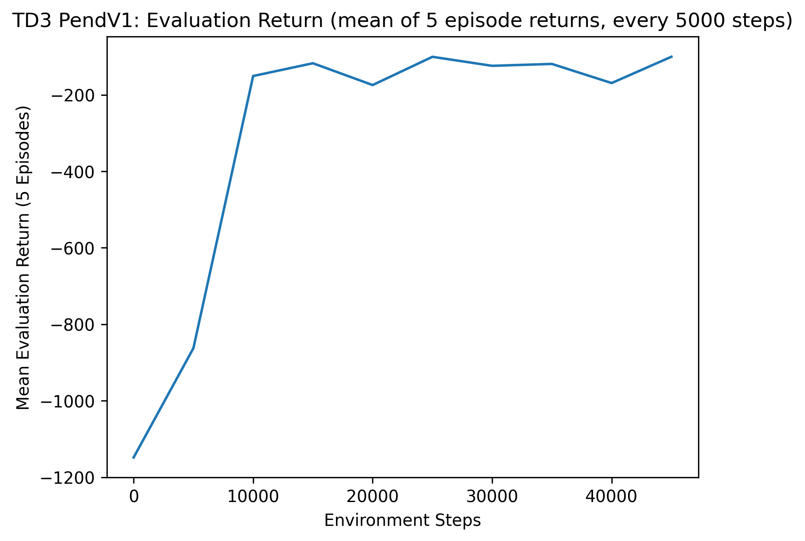
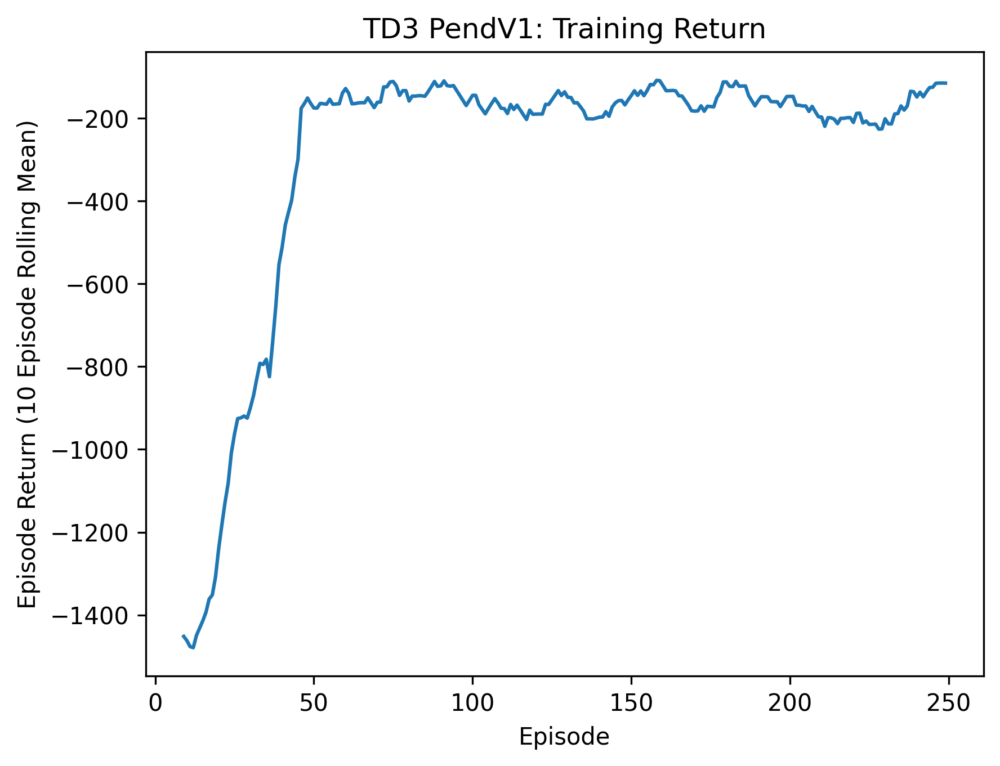
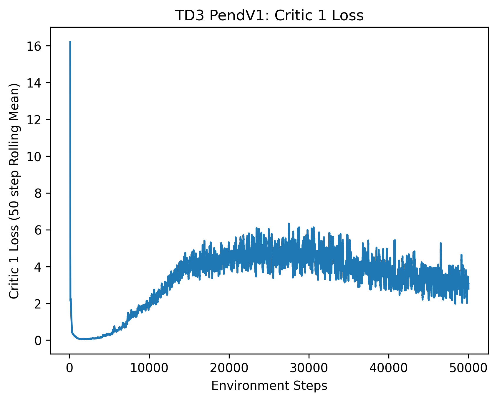
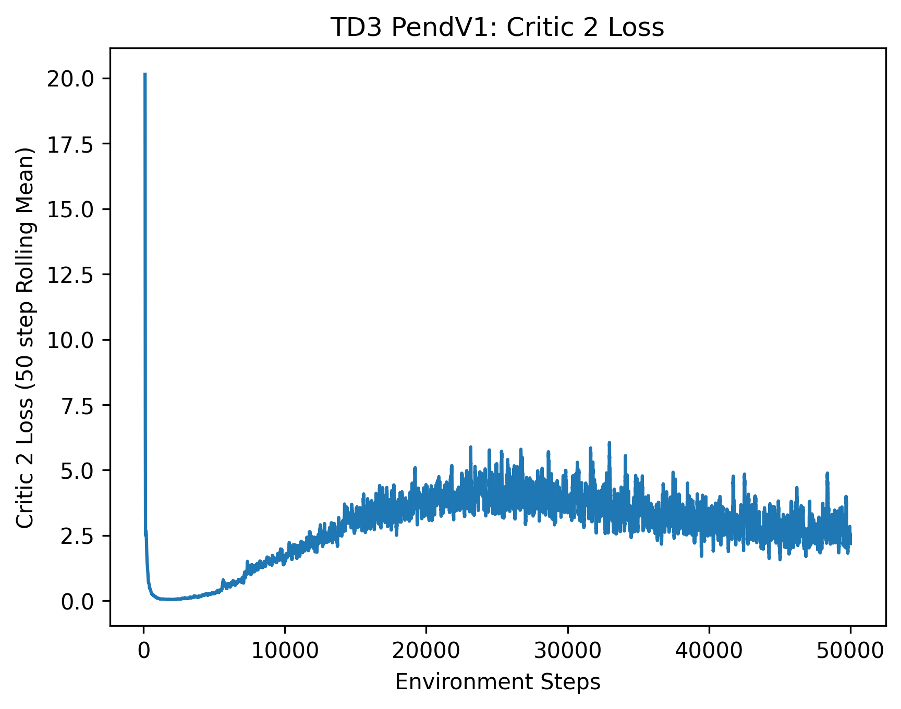
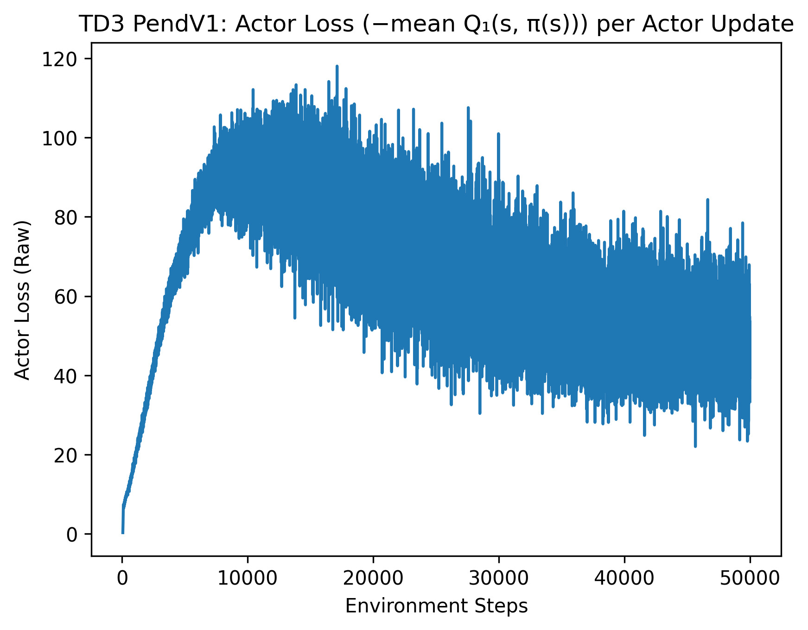
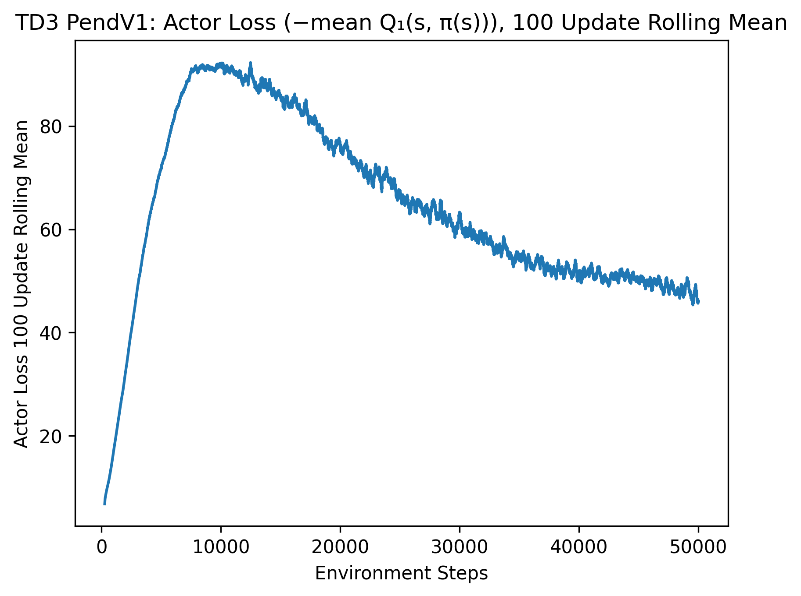
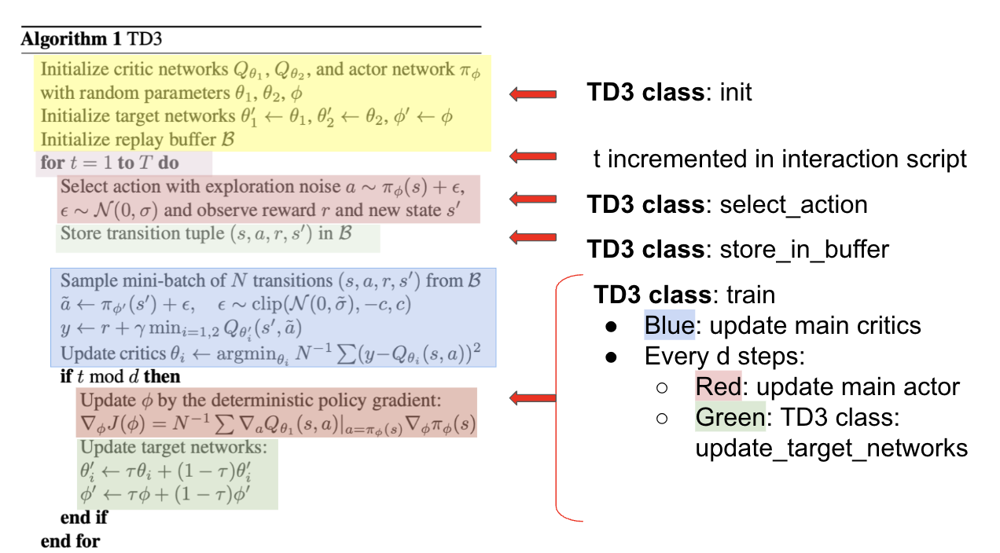

# Project Goal: 
Implement TD3 class for Pendulem V1 (using pytorch)

# Problem: 
Pendulem starts at a random angle. The agent must swing it up and balance it upright by applying a torque. The torque may be too weak to lift the pendulem on its own, so the agent must learn to swing it back and forth. 

Context: 
- Observation (state): [cosθ, sinθ, angular velocity]
- Action: one continuous value (torque) from -2 to 2
- Episode length: Always 200 steps
- Reward: always <0, best possible reward is 0 
- Episode return = sum of the 200 step reward

# Results (Plots)




Main Notes: 
- Evaluation Return: Every 5000 env steps, deterministic policy (actor with no exploration noise) is run for 5 episodes, and the mean of the total episode return is recorded. Return is increasing over training -> policy is improving. 
- Training Return: Shows 10-episode rolling mean of the total return (accumalate reward) per episode. Similar to eval run, increases and levels off at the (-200 to -150) or better. 









# Algorithm Overview 
- Algorithm taken from https://arxiv.org/pdf/1802.09477




- 2 critics: using smallest of targets to reduce overestimation 
- Actor and Target update only every d steps 
- Target policy smoothing: clipped noise added to target actor's action when computing critic target


# Project Structure 
- td3.py: TD3 agent (action selection, critic and actor update, target network updates)
- run_td3_for_pendulem.py: interaction script between agent and environment 
- actor_critic_networks.py classes for defining the actor and critic networks
- replay buffer.py: stores transitions
- plot_results.py: loads saved metric and generates results

** Note on replay buffer:** currently a plain python list, which is fine for 50,000 steps. of course for longer steps, i should probably use a deque that drops older transitions once it is full. 


# Hyperparameters: 
- Most hyperparamters chosen using: https://arxiv.org/pdf/1802.09477


| Hyperparameter | Value | Description | Why chosen |
|---|---|---|---|
| action_magnitude | 2 | Max absolute action | Pendulum-v1 torque range is [-2, 2] |
| sigma_exp_noise | 0.2 | Std of Gaussian exploration noise added to actions during training | Paper uses 0.1 for actions in [-1, 1]; scaled ×2 to match Pendulum's range |
| N | 64 | Mini-batch size | Working default|
| gamma | 0.99 | Discount factor | Standard value; Pendulum needs a long enough horizon to plan the swing-up |
| sigma_tilda | 0.4 | Std of target policy smoothing noise | Paper uses 0.2; scaled ×2 for the ±2 action range |
| c | 1 | Clip range for the smoothing noise | Paper uses 0.5; scaled ×2 for the ±2 action range |
| d | 2 | Policy delay (actor and target updates every d critic updates) | Paper's default|
| tau | 0.005 | Polyak averaging rate for target networks | Paper's default  |
| lr_critic | 0.001 | Adam learning rate for critics | Working default |
| lr_actor | 0.001 | Adam learning rate for actor | Working default |

# Additional Information:
- Dependencies: torch, gymnasium, numpy, pandas, matplotlib
- Training metrics (.npy file) save in 'results'
- Plots saved in results/plots
- To train the agent and generate graphs: 
```bash
python run_td3_for_pendulum.py
```
